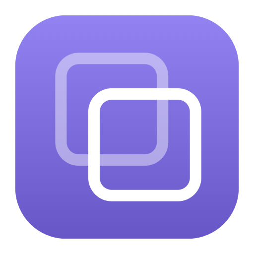

<p align="center">
  
</p>

# Recolle

**Copiez. Retrouvez. Recollez.** Un historique de presse-papier léger et local pour macOS, avec une interface en français. Gratuit, open source, sans compte, sans serveur et sans télémétrie.

**[Télécharger Recolle pour Mac Apple Silicon](https://github.com/isaac24080824/recolle/releases/download/v1.2.1/Recolle-macOS-AppleSilicon.zip)** · [Toutes les versions](https://github.com/isaac24080824/recolle/releases) · [Signaler un bug](https://github.com/isaac24080824/recolle/issues)


[](LICENSE)

## Compatibilité

- **macOS 14 ou supérieur, sur Mac Apple Silicon** : M1, M2, M3, M4 et générations suivantes compatibles.
- Le téléchargement actuel ne prend pas en charge les Mac Intel ni Windows.
- L’interface est en français.
- Première distribution publique : signature locale, **sans notarisation Apple**. Une autorisation manuelle peut être nécessaire lors de la première ouverture.

## Installation

1. [Téléchargez l’application](https://github.com/isaac24080824/recolle/releases/download/v1.2.1/Recolle-macOS-AppleSilicon.zip), puis ouvrez le fichier ZIP.
2. Glissez **Recolle.app** dans votre dossier **Applications**.
3. Ouvrez Recolle. Si macOS indique qu’il ne peut pas vérifier le développeur, consultez les explications ci-dessous avant de continuer.
4. Si macOS demande l’accès au presse-papier, autorisez-le pour activer l’historique.
5. Copiez quelque chose dans une autre application avec **⌘C**, puis ouvrez l’historique avec **⌥W** ou l’icône à deux carrés dans la barre de menus.

### Première ouverture et sécurité macOS

Cette version n’a pas été notarisée par Apple. Téléchargez-la depuis ce dépôt et n’autorisez son ouverture que si vous faites confiance à cette source.

Après une première tentative d’ouverture, **Réglages Système → Confidentialité et sécurité → Ouvrir quand même** peut permettre d’autoriser cette application. Suivez la [procédure officielle Apple](https://support.apple.com/fr-fr/102445). Il n’est pas nécessaire de désactiver globalement Gatekeeper ni d’exécuter une commande dans le Terminal.

L’archive est accompagnée d’un fichier `SHA256SUMS.txt` dans la [version publiée](https://github.com/isaac24080824/recolle/releases/tag/v1.2.1). Il permet de contrôler l’intégrité du téléchargement ; il ne remplace pas une signature Developer ID ou une notarisation Apple.

## Ce que fait Recolle

- Conserve les **textes, liens, images PNG/TIFF/JPEG et références de fichiers** copiés après son ouverture.
- Recherche dans le contenu et le nom de l’application source, sans tenir compte de la casse ni des accents.
- Regroupe les doublons exacts et compte leurs réutilisations.
- Garde vos favoris, avec des filtres par type de contenu.
- Offre un petit **bouton de copie sur chaque ligne**, qui garde la fenêtre ouverte, la sélection et la position de la ligne.
- Préserve les formats HTML/RTF lorsqu’ils accompagnent le texte, avec une option de recopie en texte brut.
- Propose une pause, des applications exclues, une durée de conservation et le démarrage à la connexion.
- Conserve l’historique après fermeture et redémarrage ; les opérations de stockage et la préparation des aperçus s’effectuent en arrière-plan.

Les fichiers copiés restent à leur emplacement d’origine : Recolle mémorise leurs références, sans dupliquer les fichiers eux-mêmes.

## Utilisation et raccourcis

| Action | Raccourci ou geste |
| --- | --- |
| Ouvrir ou masquer l’historique | **⌥W** — Option + W |
| Chercher | **⌘F** |
| Ajouter ou retirer un favori | **⌘D** |
| Recopier l’élément sélectionné | **Entrée**, bouton **Recopier** ou double-clic |
| Recopier sans mise en forme | **⌘⇧C** |
| Copier directement sans déplacer la ligne ni fermer la fenêtre | Petit bouton à deux carrés sur la ligne |
| Réglages | **⌘,** |
| Quitter et arrêter l’enregistrement | **⌘Q** |

Après une recopie, utilisez **⌘V** dans votre application. Si l’historique a été ouvert avec le raccourci ou la barre de menus, la recopie classique revient dans l’application précédente. La copie rapide par ligne garde la fenêtre ouverte.

Fermer la fenêtre laisse Recolle fonctionner dans la barre de menus. Pour retrouver l’historique après une nouvelle connexion au Mac, activez **Ouvrir Recolle à la connexion** dans les réglages.

Si ⌥W est déjà utilisé par une autre application, utilisez l’icône dans la barre de menus. Le choix d’un autre raccourci dans l’interface n’est pas encore disponible.

## Vos données et les limites

**L’historique reste sur votre Mac.** Recolle ne transmet pas vos copies, n’intègre aucun service distant et ne nécessite aucune clé API.

- Stockage : `~/Library/Application Support/Recolle/history.sqlite` et les fichiers auxiliaires SQLite.
- Dossier privé à votre compte Mac et fichier en mode 0600. **L’application ne chiffre pas séparément la base.**
- Les gestionnaires de mots de passe connus et les copies signalées comme confidentielles, transitoires ou générées automatiquement sont exclus.
- Cela ne détecte pas tous les secrets : un mot de passe copié depuis un navigateur ou un document peut être enregistré. Utilisez la **pause** ou excluez les applications concernées si nécessaire.
- Jusqu’à **5 000 éléments**, **250 Mo estimés** et **12 Mo par copie**. À capacité atteinte, les plus anciens éléments sans étoile sont retirés ; les favoris sont conservés. Si les favoris occupent toute la capacité, Recolle demande de libérer de l’espace.
- Sans limite de durée par défaut ; conservation de 7, 30 ou 90 jours au choix. Les favoris échappent à la purge automatique.
- L’effacement complet demande confirmation et retire aussi les favoris, sans modifier le presse-papier actuel.
- Le presse-papier est examiné toutes les **150 ms**. Plusieurs copies entre deux passages peuvent ne laisser que la dernière. Les formats propriétaires non pris en charge sont ignorés.
- Seules les nouvelles copies pendant l’exécution de Recolle sont collectées. Aucune récupération des copies antérieures à son lancement n’est possible.
- L’application source correspond à l’application au premier plan au moment de la détection.

## Construire depuis les sources

Outils développeur Apple récents avec un SDK macOS 15.4 ou supérieur, Swift 5.9 ou supérieur et un Mac pour construire l’application. Le téléchargement produit cible Apple Silicon et macOS 14 ou supérieur.

```sh
git clone https://github.com/isaac24080824/recolle.git
cd recolle
./build.sh
./test.sh
```

L’application est créée dans `dist/Recolle.app`. Pour l’ouvrir :

```sh
open dist/Recolle.app
```

Pour générer l’archive téléchargeable et son empreinte SHA-256 :

```sh
./package.sh
```

Aucune dépendance externe, aucun serveur et aucun compte développeur payant ne sont nécessaires pour cette construction avec signature locale. Une distribution signée avec Developer ID et notarisée reste un travail distinct.

## Structure du projet

- `Sources/` : application SwiftUI/AppKit, capture, stockage SQLite et raccourci.
- `Tests/` : vérifications du stockage, des formats et des traitements asynchrones.
- `Tools/` : génération de l’icône et mesures sur données fictives.
- `build.sh`, `test.sh`, `package.sh` : construction, vérification et archive de distribution.
- `measure.sh` : mesures sur 5 000 copies fictives dans un dossier temporaire.

Les tests utilisent un historique temporaire et un presse-papier nommé séparé, sans lire ni modifier le presse-papier personnel. Les fichiers générés, historiques, certificats et données locales sont exclus du dépôt.

[Contribuer](CONTRIBUTING.md) · [Historique des versions](CHANGELOG.md)

## Licence

[MIT](LICENSE) — Copyright © 2026 [isaac24080824](https://github.com/isaac24080824).
